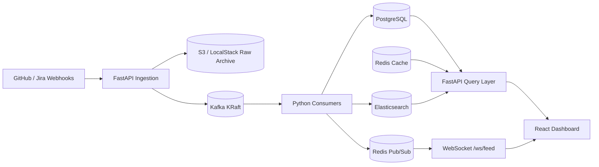

# Architecture

> Living document — stubbed in Phase 0 and expanded as each phase is built.

## High-Level Data Flow

## Ingestion Layer

1. **Webhook Endpoints (`backend/app/routers/webhooks.py`):**
   - `POST /webhooks/github` verifies `X-Hub-Signature-256` HMAC-SHA256 using constant-time `hmac.compare_digest` against `GITHUB_WEBHOOK_SECRET`.
   - `POST /webhooks/jira` verifies `X-Jira-Webhook-Secret` using `hmac.compare_digest` against `JIRA_WEBHOOK_SECRET`.
   - Unconfigured secrets fail closed (`500`); invalid or missing signatures return `401` using the standard `{ "error", "detail" }` error format.
2. **Per-Secret Rate Limiting (`backend/app/services/rate_limit.py`):**
   - Executed *after* signature validation using `slowapi` backed by Redis (`WEBHOOK_RATE_LIMIT`, default `100/minute`), keyed by `webhook:{source}:{sha256(secret)[:16]}`.
   - Exceeding the limit returns `429` with `Retry-After` and `{ "error": "rate_limit_exceeded", "detail", "retry_after" }`.
3. **Idempotency (`backend/app/services/idempotency.py`):**
   - Atomic `SET seen:events:{event_id} "1" EX 86400 NX` deduplicates retries and returns `202` without re-archiving or republishing.
   - If S3 or Kafka fails before ack, the key is deleted so source retries are not silently lost.
4. **S3 Raw Archive → Kafka (`backend/app/services/s3_archive.py`, `kafka_producer.py`):**
   - Raw JSON body is written asynchronously via `asyncio.to_thread(put_object)` to `raw/{source}/{YYYY}/{MM}/{DD}/{event_id}.json` in `engineering-pulse-raw-events` (LocalStack when `ENVIRONMENT=local`).
   - Canonical `WebhookEnvelope` JSON (`event_id`, `source`, `type`, `received_at`, `payload`) is then published via `AIOKafkaProducer.send_and_wait` to `github-events` or `jira-events` (`acks="all"`, `request_timeout_ms=30000`, `retry_backoff_ms=500`).

## Consumer & Storage Layer

1. **Independent Consumer Services (`backend/app/consumers/`):**
   - `github_consumer` (`github-events`), `jira_consumer` (`jira-events`) in group `engineering-pulse-consumers`, and `dlq_consumer` (`events-dlq`) in group `engineering-pulse-dlq-consumers`.
   - Each uses `enable_auto_commit=False`, `TrackingRebalanceListener` on partition revocation, and per-record commits (`{TopicPartition: offset + 1}`) only after successful persistence (or DLQ handoff).
   - Startup waits on `alembic_version` via `scripts/wait-for-migrations.sh` (`python -m app.db.wait_for_migrations`).
2. **PostgreSQL & Connection Pooling (`backend/app/db/`, `backend/alembic/`):**
   - Source-of-truth tables (`pull_requests`, `commits`, `jira_tickets`, `jira_transitions`, `failed_events`) with `TIMESTAMP WITH TIME ZONE`, indexes on query/filter columns, and idempotent upserts (`ON CONFLICT`).
   - Per-service `asyncpg.create_pool()` (`api` 5–10, `github-consumer` 2–5, `jira-consumer` 2–5, `dlq-consumer` 1–2) instrumented via `postgres_pool_active_connections{service}`.
3. **Elasticsearch (`backend/app/services/es_index.py`):**
   - Writes after PostgreSQL commit to alias `engineering-events` → `engineering-events-v1`, guarded by `ES_ENABLED`.
4. **Redis Cache & Pub/Sub (`backend/app/services/cache.py`, `pubsub.py`):**
   - Invalidates `metrics:prs_merged_today`, `metrics:avg_cycle_time_7d`, and `sprint:active:{project_key}` on writes and publishes `{ "type": "event", ... }` summaries to Redis Pub/Sub `live-feed`.

## API & WebSocket Layer

1. **Read-Through Metrics & Search REST Endpoints (`backend/app/routers/metrics.py`, `backend/app/db/repositories.py`):**
   - `GET /api/metrics/summary`, `GET /api/metrics/prs?range=7d|14d|30d|90d`, `GET /api/metrics/cycle-time?range=7d|14d|30d|90d`, `GET /api/sprint/active`, and `GET /api/search?q=...` all read Redis first via `get_or_compute_cached` (5m TTL for metrics, 1m TTL for sprint/search) before falling back to PostgreSQL or Elasticsearch (`engineering-events` alias when `ES_ENABLED=true`, PostgreSQL `ILIKE` fallback when `ES_ENABLED=false`).
   - `GET /health` returns service status, `ENVIRONMENT`, and UTC `Z` timestamp.
2. **Consistent Error Envelope (`backend/app/main.py`, `frontend/src/lib/api.ts`):**
   - Global exception handlers catch `StarletteHTTPException` (including `400`, `401`, `404`), `RequestValidationError` (`422`), `RateLimitExceeded` (`429` with `retry_after`), and unhandled `Exception` (`500`), returning `{ "error", "detail", "retry_after"? }`.
   - Frontend `axios` response interceptor extracts `detail` and `retry_after` for user-facing error states.
3. **WebSocket Live Feed (`backend/app/routers/ws.py`, `backend/app/services/pubsub.py`):**
   - `WS /ws/feed` subscribes to Redis Pub/Sub `live-feed` on connect, forwards normalized `{ "type": "event" | "alert", "source", "event_type", "timestamp", "data" }` frames, accepts client `{ "type": "auth", "token" }` messages (enforced in Phase 3A), and unsubscribes/closes Pub/Sub cleanly on disconnect.
4. **Prometheus Instrumentation (`backend/app/services/metrics.py`, `backend/app/main.py`):**
   - `prometheus-fastapi-instrumentator` exposes HTTP metrics alongside custom metrics `webhook_events_received_total`, `cache_hit_ratio`, `kafka_consumer_lag`, and `postgres_pool_active_connections` on `GET /metrics`.

## AWS Infrastructure

- **Networking (`infra/modules/vpc`):** VPC across 2 AZs with public subnets (ALB + NAT Gateway + EC2) and private subnets (RDS), isolating ports (`80/443` public on ALB → `8000` on EC2 → `5432` on RDS; SSH disabled by default in favor of AWS SSM).
- **Compute & App Stack (`infra/modules/ec2`, `docker-compose.prod.yml`):** Single `t3.large` (8GB RAM, 50GB encrypted `gp3` EBS, Docker `50m x 3` log rotation) running Kafka (KRaft, 7d/1GB retention), `kafka-init`, Redis, Prometheus (`15d`/`5GB` retention), Grafana, FastAPI, and the three Kafka consumers with `ES_ENABLED=false` during Phases 1–4.
- **Database & Secrets (`infra/modules/rds`):** Private RDS PostgreSQL 16 (`db.t3.micro`, 7-day backups, encryption at rest) using AWS-managed Secrets Manager (`manage_master_user_password = true`) plus an app secret fetched at bootstrap via a least-privilege IAM instance profile (IMDSv2, zero static AWS keys).
- **Frontend & Ingestion Edge (`infra/modules/alb`, `infra/modules/s3`, `infra/modules/cloudfront`):** ALB health-checking `GET /health` forwards API/WebSocket traffic (`120s` idle timeout) to EC2:8000; static Vite assets sit in a private versioned S3 bucket served over HTTPS via CloudFront Origin Access Control (OAC), alongside a dedicated private S3 bucket for raw webhook archives (`30d` → `STANDARD_IA`, `365d` expiration).

