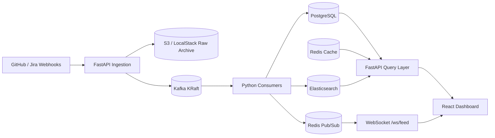

# Architecture

> Living document — stubbed in Phase 0 and expanded as each phase is built.

## High-Level Data Flow

## Ingestion Layer

1. **Webhook Endpoints (`backend/app/routers/webhooks.py`):**
   - `POST /webhooks/github` verifies `X-Hub-Signature-256` HMAC-SHA256 using constant-time `hmac.compare_digest` against `GITHUB_WEBHOOK_SECRET`.
   - `POST /webhooks/jira` verifies `X-Jira-Webhook-Secret` using `hmac.compare_digest` against `JIRA_WEBHOOK_SECRET`.
   - Unconfigured secrets fail closed (`500`); invalid or missing signatures return `401` using the standard `{ "error", "detail" }` error format.
2. **Per-Secret Rate Limiting (`backend/app/services/rate_limit.py`):**
   - Executed *after* signature validation using `slowapi` backed by Redis (`WEBHOOK_RATE_LIMIT`, default `100/minute`), keyed by `webhook:{source}:{sha256(secret)[:16]}`.
   - Exceeding the limit returns `429` with `Retry-After` and `{ "error": "rate_limit_exceeded", "detail", "retry_after" }`.
3. **Idempotency (`backend/app/services/idempotency.py`):**
   - Atomic `SET seen:events:{event_id} "1" EX 86400 NX` deduplicates retries and returns `202` without re-archiving or republishing.
   - If S3 or Kafka fails before ack, the key is deleted so source retries are not silently lost.
4. **S3 Raw Archive → Kafka (`backend/app/services/s3_archive.py`, `kafka_producer.py`):**
   - Raw JSON body is written asynchronously via `asyncio.to_thread(put_object)` to `raw/{source}/{YYYY}/{MM}/{DD}/{event_id}.json` in `engineering-pulse-raw-events` (LocalStack when `ENVIRONMENT=local`).
   - Canonical `WebhookEnvelope` JSON (`event_id`, `source`, `type`, `received_at`, `payload`) is then published via `AIOKafkaProducer.send_and_wait` to `github-events` or `jira-events` (`acks="all"`, `request_timeout_ms=30000`, `retry_backoff_ms=500`).

## Consumer & Storage Layer

_To be filled in Phase 1.2._

## API & WebSocket Layer

_To be filled in Phase 1.3._

## AWS Infrastructure

_To be filled in Phase 1.5._

