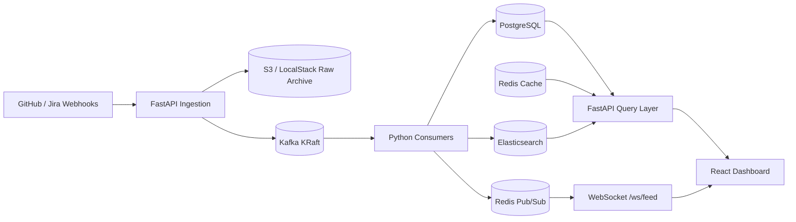

# Architecture

> Living document — stubbed in Phase 0 and expanded as each phase is built.

## High-Level Data Flow

## Ingestion Layer

_To be filled in Phase 1.1._

## Consumer & Storage Layer

_To be filled in Phase 1.2._

## API & WebSocket Layer

_To be filled in Phase 1.3._

## AWS Infrastructure

_To be filled in Phase 1.5._

