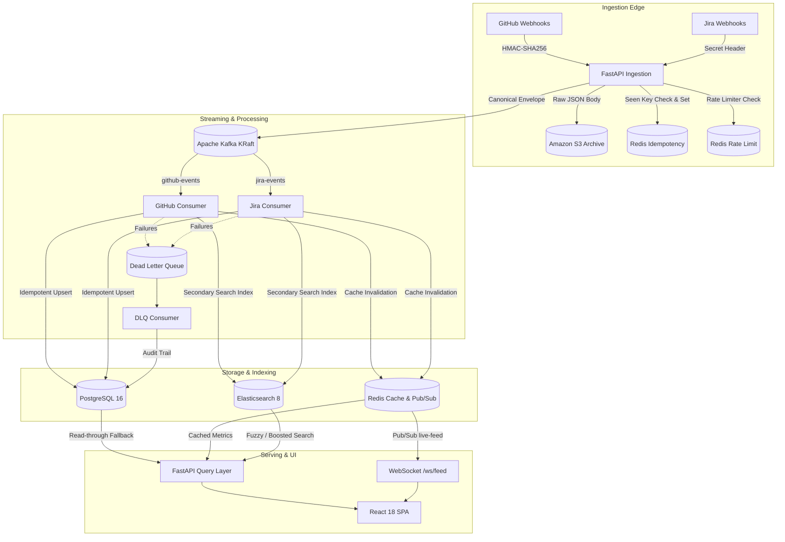

# Engineering Pulse

[](https://github.com/placeholder-org/engineering-pulse/actions/workflows/ci.yml)
[](https://opensource.org/licenses/MIT)
[](https://www.python.org/)
[](https://react.dev/)

**Engineering Pulse** is a real-time engineering metrics aggregator and developer workflow pipeline. It ingests high-volume webhook events from GitHub and Jira, streams them through Apache Kafka into PostgreSQL, Redis, and Elasticsearch, and delivers live throughput analytics, sprint cycle times, and real-time event feeds to an interactive React dashboard.

Designed with production-grade reliability patterns: cryptographic signature validation, per-secret rate limiting, atomic deduplication, crash-isolated consumers with per-record offset commits, dead-letter queue recovery, Prometheus/Grafana observability, automated CI/CD with zero-downtime rollback, and modular Terraform infrastructure on AWS.

---

## Architecture Overview



---

## Tech Stack & Justifications

| Component | Technology | Why This Choice? |
| :--- | :--- | :--- |
| **Ingestion & Query API** | FastAPI (Python 3.12) | Native async I/O handles concurrent webhook bursts, WebSockets, and Pydantic validation with minimal overhead. |
| **Event Streaming** | Apache Kafka 7.6 (KRaft) | High-throughput distributed partition log with crash-isolated consumer offset tracking; KRaft eliminates Zookeeper. |
| **Primary Database** | PostgreSQL 16 (`asyncpg`) | Relational source-of-truth with ACID guarantees, idempotent upserts (`ON CONFLICT`), and JSONB flexibility. |
| **Caching & Pub/Sub** | Redis 7 | Sub-millisecond read-through cache for aggregated metrics and lightweight real-time event broadcasting to WebSockets. |
| **Search Engine** | Elasticsearch 8.13 | Fast full-text and fuzzy search across PR titles, commit messages, and Jira ticket summaries with field boosting. |
| **Frontend UI** | React 18 + Vite + Recharts | Responsive, type-safe single-page dashboard with debounced search, auto-reconnecting WebSockets, and data visualizations. |
| **Observability** | Prometheus + Grafana | Automated pull-based metrics collection scraping API latency, Kafka consumer lag, DB pool saturation, and pre-built dashboards. |
| **Infrastructure as Code** | Terraform (AWS) | Modular, reproducible infrastructure provisioning VPC, private RDS, S3, CloudFront OAC, and ALB with zero manual steps. |
| **Load Testing** | Locust | Python-driven headless load testing simulating concurrent query load and signed webhook ingestion. |

---

## Quickstart: Local Setup in 5 Minutes

### 1. Prerequisites
- Docker Desktop (with Compose v2)
- Python 3.12+
- Node.js 20+

### 2. Launch Local Infrastructure
```bash
# Clone the repository
git clone https://github.com/placeholder-org/engineering-pulse.git
cd engineering-pulse

# Copy default environment variables
cp .env.example .env

# Start core services (Kafka, Postgres, Redis, LocalStack, Elasticsearch, Prometheus, Grafana, Node Exporter)
docker compose up -d
```

### 3. Run Backend API
```bash
cd backend
python -m venv .venv
# Activate virtual environment:
# Windows: .venv\Scripts\activate | macOS/Linux: source .venv/bin/activate
pip install -e ".[dev]"
alembic upgrade head
uvicorn app.main:app --reload
```
API runs at `http://localhost:8000` (Health check: `GET http://localhost:8000/health`).

### 4. Run Frontend Dashboard
```bash
cd ../frontend
npm install
npm run dev
```
Dashboard opens at `http://localhost:5173`.

### 5. Seed Historical Data (Optional)
```bash
# Seed 90 days of realistic developer activity (PRs, commits, sprints, transitions)
python scripts/seed.py --days 90 --teams 2 --repos 3 --volume 1
```

---

## Dashboards & Observability

- **Application Dashboard:** `http://localhost:5173`
  - *Overview Panel:* PRs merged today, 7-day average cycle time, open PRs, active tickets, throughput bar chart, 30-day rolling cycle time line chart, and real-time streaming feed.
  - *Sprint Board:* Multi-project Kanban board (`To Do`, `In Progress`, `Done`) with dynamic custom statuses.
  - *Search Panel:* Instant debounced search querying Elasticsearch (or Postgres fallback).
- **Grafana Observability:** `http://localhost:3000` (`admin` / `admin`)
  - *Business Dashboard (`ep-business-metrics`):* Accepted PRs, Jira issues, deduplication counts, Kafka lag per partition, throughput rates.
  - *Infrastructure Dashboard (`ep-infra-metrics`):* API req/s, P99 latency percentiles, HTTP 5xx error rate, Postgres pool active connections, Redis cache hit ratio.
- **Prometheus Server:** `http://localhost:9090`
  - Production alert rules: `KafkaConsumerLagHigh` (lag > 1000 for 5m), `HighHttpErrorRate` (5xx > 5% for 2m).

---

## Baseline Performance Numbers

Measured locally using headless Locust ([`backend/locustfile.py`](backend/locustfile.py)) against the running multi-container stack:

| Endpoint / Operation | Requests | Failures | Median | Avg | P99 Latency | Throughput |
| :--- | ---: | ---: | ---: | ---: | ---: | ---: |
| `POST /webhooks/github` (Ingest + S3 + Kafka) | 10 | 0 (0%) | 56 ms | 68.2 ms | 120 ms | 0.53 req/s |
| `GET /api/metrics/summary` (Redis Cached) | 32 | 0 (0%) | 3 ms | 4.5 ms | 42 ms | 1.68 req/s |
| `GET /api/metrics/prs?range=7d` | 12 | 0 (0%) | 3 ms | 8.1 ms | 50 ms | 0.63 req/s |
| `GET /api/metrics/cycle-time?range=30d` | 16 | 0 (0%) | 4 ms | 3.9 ms | 6 ms | 0.84 req/s |
| `GET /api/sprint/active` | 4 | 0 (0%) | 5 ms | 5.1 ms | 7 ms | 0.21 req/s |
| `GET /health` | 7 | 0 (0%) | 2 ms | 9.7 ms | 54 ms | 0.37 req/s |
| **Aggregated System Under Load** | **81** | **0 (0%)** | **3 ms** | **13.3 ms** | **120 ms** | **4.26 req/s** |

- **Kafka Consumer Lag:** `0.0` steady state across all 6 partitions (`github-events`, `jira-events`).
- **Redis Cache Hit Ratio:** `0.631` under active webhook write invalidation.

---

## CI/CD & Production Deployment

- **Continuous Integration (`.github/workflows/ci.yml`):**
  - Runs on every push and PR: Ruff linting, Pytest test suite, Node TypeScript compile, frontend test runner, and Docker Compose validation.
- **Continuous Deployment (`deploy-backend.yml`, `deploy-frontend.yml`):**
  - Backend: SSH to EC2, captures `/tmp/last-good-sha`, pulls code, runs `alembic upgrade head` before container rebuild, drains WebSockets (`POST /admin/drain-ws`), rebuilds containers, and auto-rolls back if `/health` fails within 30s.
  - Frontend: Builds Vite bundle, syncs to S3 bucket, and triggers CloudFront cache invalidation for `/index.html` only.

---

## Documentation Index

- [Architecture Deep Dive](ARCHITECTURE.md) — Full data flow narrative, technology justifications, 10x scale design, and trade-offs.
- [Testing Strategy](TESTING.md) — Unit tests, integration tests, mock boundaries, and what is intentionally omitted.
- [Operations Runbook](RUNBOOK.md) — AWS provisioning, remote state bootstrap, backup restoration drills, and rollback procedures.
- [Architectural Decisions (ADRs)](DECISIONS.md) — 24 documented Architectural Decision Records (`ADR-001` through `ADR-024`).
- [AI Build Log](AI_BUILD_LOG.md) — Engineering log of problems solved, AI interactions, and verified code patterns.
- [Performance Benchmarks](PERFORMANCE.md) — Load testing methodology and performance logs.
- [Contributing Guidelines](CONTRIBUTING.md) — How to add event types, metrics, and manage database migrations safely.
- [Changelog](CHANGELOG.md) — Version history across project phases.
